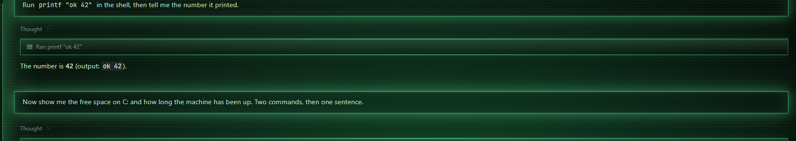
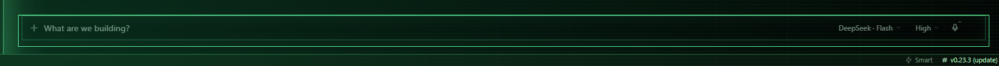

# LILYTHIUM 02 — Mainframe Access for Hermes Desktop

A phosphor-green terminal skin for Hermes. Agent replies read as lit glass plates, the
prompt burns a step hotter than the reply, and the sidebar seam throws light across the
transcript.





Part of LILYTHIUM, a set of places that get ported to whatever surface needs a face. This
is the port to Hermes Desktop, from the [mainframe-access design
kit](https://ionshieldquad.github.io/design-kits/kits/mainframe-access/index.html).

## Install

```bash
mkdir -p ~/.hermes/skins
curl -fsSL -o ~/.hermes/skins/lilythium-mainframe-access.yaml \
  https://raw.githubusercontent.com/IonShieldQuad/hermes-skins/v1.0.0/skins/lilythium-mainframe-access.yaml
hermes config set display.skin lilythium-mainframe-access
```

Restart the desktop app, or pick the skin in **Settings → Appearance**. It also applies to
the CLI and the TUI, because a Hermes skin themes all three at once.

Remove it with `rm ~/.hermes/skins/lilythium-mainframe-access.yaml` after switching to
another skin.

Requires a Hermes build whose desktop applies a skin's `customCSS`; this was written and
verified against 0.23.3. On older builds the palette applies but the plates do not.

## What it does

| Surface | Treatment |
|---|---|
| Every tool call, file card, diff | its own full-width plate: square corners, a pale gloss band across the crown, a 1 px accent hairline that runs dim at the corners and full green through the middle, a ring and a soft bloom |
| Agent prose | unframed. The text is the field the plates sit on, not another box |
| Thinking rows | a bare label. They are collapsed 20 px affordances; framing one turns it into a horizontal rule and the transcript into a striped wall |
| Your prompt | true black face, same geometry as the plates, hairline at full accent, wider bloom. Darker than a reply and brighter at the edge, so the two never read as the same object |
| Composer | the same hot stroke as the prompt, plus a focus state that lifts the hairline without moving the box |
| Sidebar seam | an accent gradient falling off over 72 px into the transcript |
| Ground | black-green with a fine scanline and two dim scene glows, painted as one fixed overlay below the UI |

Body text is 13 px base, which the app scales to about 14.3 px in the conversation column.
Chakra Petch for signage, JetBrains Mono for everything else.

## Palette

| Role | Value |
|---|---|
| Accent | `#5CF79B` |
| Accent ink (text, hairlines) | `#BCF7CE` |
| Body text | `#C8EED4` |
| Ground | `#020704` |
| Panel face | `#071009` |
| Alert | `#FF7070` |
| Warning | `#FFC04D` |

Contrast of body text on the ground is 16.8:1. Green stays semantic for "ok"; error and
warning are kept away from the place's own hue so the status ladder still reads.

## How it is built

One YAML file: a `colors` block the app reads for tokens, and one `customCSS` string the
desktop injects as a `<style>` tag. No plugin, no patching of the app bundle, nothing that
breaks when Hermes updates.

The selectors target the app's own `data-slot` attributes (`tool-block`,
`aui_assistant-message-root`, `composer-dock`, `aui_user-message-root` and friends), so they
survive restyles. Three findings are baked into the CSS and worth knowing if you fork it:

- **`background-clip` is per-layer.** The app sets `padding-box` on the prompt bubble, which
  silently swallows a `border-box` gradient. Any element that carries a black face and a
  gradient border has to declare `background-clip: padding-box, padding-box, border-box`.
- **`translate`, not `transform`.** The composer is centred by Tailwind v4's
  `-translate-x-1/2`, which writes the `translate` property. A `transform` override does
  nothing and margins can never align it. `translate: none` plus `left`/`right` insets is the
  only combination that lands it on the transcript column at any window width.
- **`clip-path` clips `box-shadow`.** The composer is squared off with a `clip-path`, so its
  glow lives in `box-shadow` on the same element only because the clip is a plain rectangle.
  A chamfered plate from one of the other LILYTHIUM places needs its bloom moved to a wrapper.

## Why not in the plugin catalog

Hermes themes travel as skins, not plugins. The catalog at
`hermes-agent.nousresearch.com/marketplace` lists plugins only, pinned to a reviewed commit,
and a skin has no plugin entrypoint to pin. Getting listed would mean wrapping this in a
tiny desktop plugin that registers the theme through the plugin SDK, which is a different
artefact from the skin itself.

## License

MIT. Fonts are loaded from Google Fonts at runtime and are not bundled.
